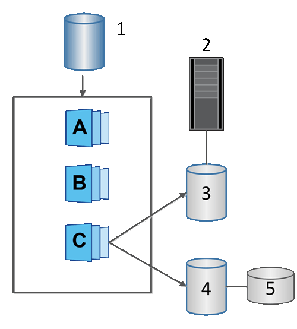

= 了解 SANtricity 软件中的快照卷
:allow-uri-read: 
:icons: font
:imagesdir: ../media/

[role="lead"]
如果要读取或写入 snapshot 数据，可以创建 snapshot 卷并将其分配给主机。snapshot 卷与基本卷具有相同的特性（RAID 级别、I/O 特性等）。

创建快照卷时，可以将其指定为__只读__或_读写访问_。

创建只读快照卷时，无需添加保留容量。创建读写快照卷时，必须添加保留容量以提供写入访问。

^1^ 基本卷；^2^ 主机；^3^ 只读 Snapshot 卷；^4^ 读写 Snapshot 卷；^5^ 预留容量
