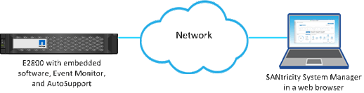

= 了解如何从 Unified Manager 访问 SANtricity System Manager
:allow-uri-read: 
:icons: font
:imagesdir: ../media/

[role="lead"]
选择一个或多个存储阵列，并在要配置和管理存储阵列时使用"启动"选项打开 SANtricity System Manager。

System Manager 是控制器上的嵌入式应用程序，通过以太网管理端口连接到网络。它包括所有基于阵列的功能。

要访问 System Manager，必须具有：

* 此处列出的阵列模型之一： link:https://docs.netapp.com/us-en/e-series/getting-started/learn-hardware-concept.html["E-Series 硬件概述"^]
* 使用 Web 浏览器与网络管理客户端的带外连接。

